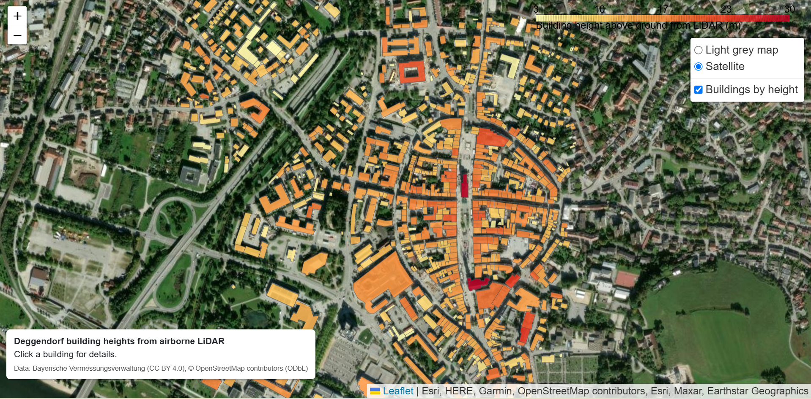
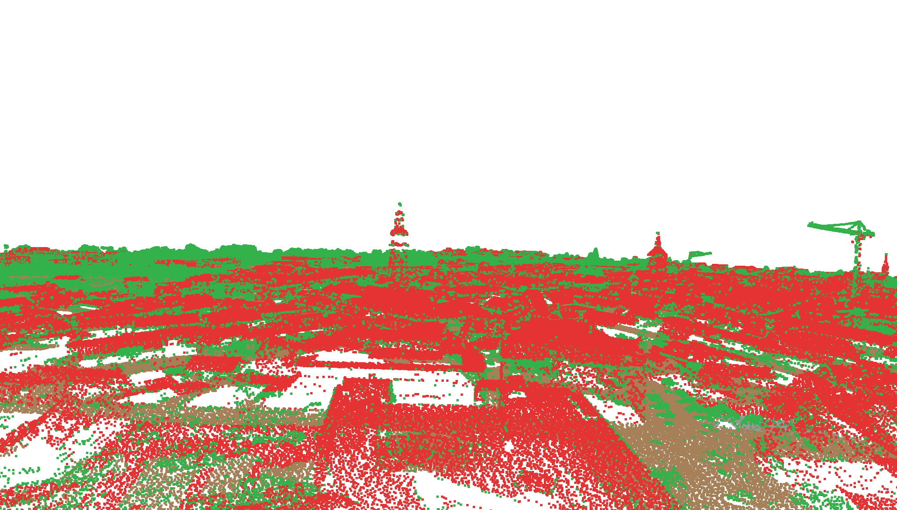
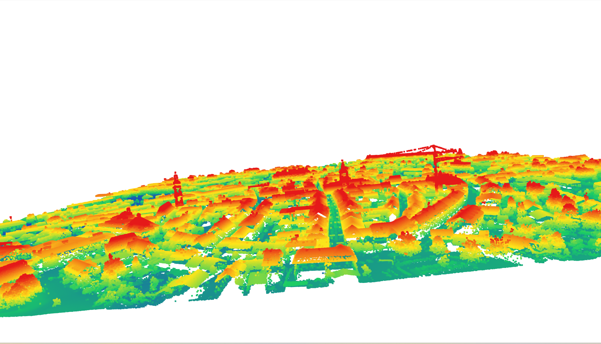

# 3D LiDAR Building Height Mapping – Deggendorf (Case Study)

Building heights for the centre of Deggendorf, derived from open airborne LiDAR data,
matched to OpenStreetMap building footprints, validated, and published as an interactive web map.

**[Open the interactive map](https://saisrujanakotte.github.io/deggendorf-lidar-building-heights/)**



## Results

| | |
|---|---|
| LiDAR points processed | 13.0 million (1 km², ~13 points/m²) |
| OSM building footprints in the tile | 974 |
| Buildings with a LiDAR-derived height | 905 |
| Median building height | 11.7 m |
| Tallest named buildings | Heilig-Grab-Kirche (43.0 m), Altes Rathaus (38.5 m), Stadtmuseum (23.5 m) |

**Validation against OpenStreetMap**

- 15 buildings carry an OSM `height` tag: mean absolute difference **3.0 m**, median difference (LiDAR − OSM) **+1.1 m**.
- 120 buildings carry an OSM floor count: correlation between LiDAR height and floors **r = 0.69**, median **4.6 m per floor**.

## Method

1. **Data** – one 1 × 1 km airborne laser scanning tile (LAZ, ETRS89 / UTM 32N, EPSG:25832) from the
   Bavarian surveying agency, already classified into ground (2), building (6) and object/vegetation (20) points.
2. **3D visualisation** – the point cloud is displayed in Open3D, coloured by class and by elevation.
3. **Ground model** – ground points are gridded into a 1 m digital terrain model; empty cells are filled from the nearest neighbour.
4. **Height above ground** – each building point's elevation minus the terrain height beneath it.
5. **Matching** – building footprints are exported from OpenStreetMap, reprojected from WGS84 to EPSG:25832,
   and LiDAR building points are assigned to footprints with a spatial index (point-in-polygon).
6. **Building height** – the 95th percentile of point heights inside each footprint (robust against outliers);
   the median is also stored as a typical roof height.
7. **Validation** – comparison with OSM `height` and `building:levels` tags.
8. **Web map** – Folium/Leaflet map with buildings coloured by height and attribute pop-ups, published with GitHub Pages.

| Coloured by class | Coloured by elevation |
|---|---|
|  |  |

## Limitations

- The 95th-percentile height measures to the roof ridge, so it is higher than eave height; this partly explains the 4.6 m per floor.
- Few OSM buildings carry a height tag (15), so the direct height validation is small.
- Buildings cut by the tile edge are excluded; towers and spires are underestimated by the percentile approach.

## Run it yourself

```
pip install -r requirements.txt
python inspect_tile.py        # summary of the LiDAR tile
python visualize_3d.py class  # 3D view (or: height)
python building_heights.py    # heights, matching, validation
python make_map.py            # writes docs/index.html
```

Download the LiDAR tile `790_5416.laz` from the Bavarian OpenData portal (geodaten.bayern.de/opengeodata, product "Laserdaten")
and the building footprints as `export.geojson` from overpass-turbo.eu.

## Data sources and licences

- LiDAR: Bayerische Vermessungsverwaltung – www.geodaten.bayern.de (CC BY 4.0)
- Building footprints: © OpenStreetMap contributors (ODbL)
- Background maps: Esri

**Tools:** Python, laspy, NumPy, pandas, GeoPandas, Shapely, SciPy, Open3D, Folium